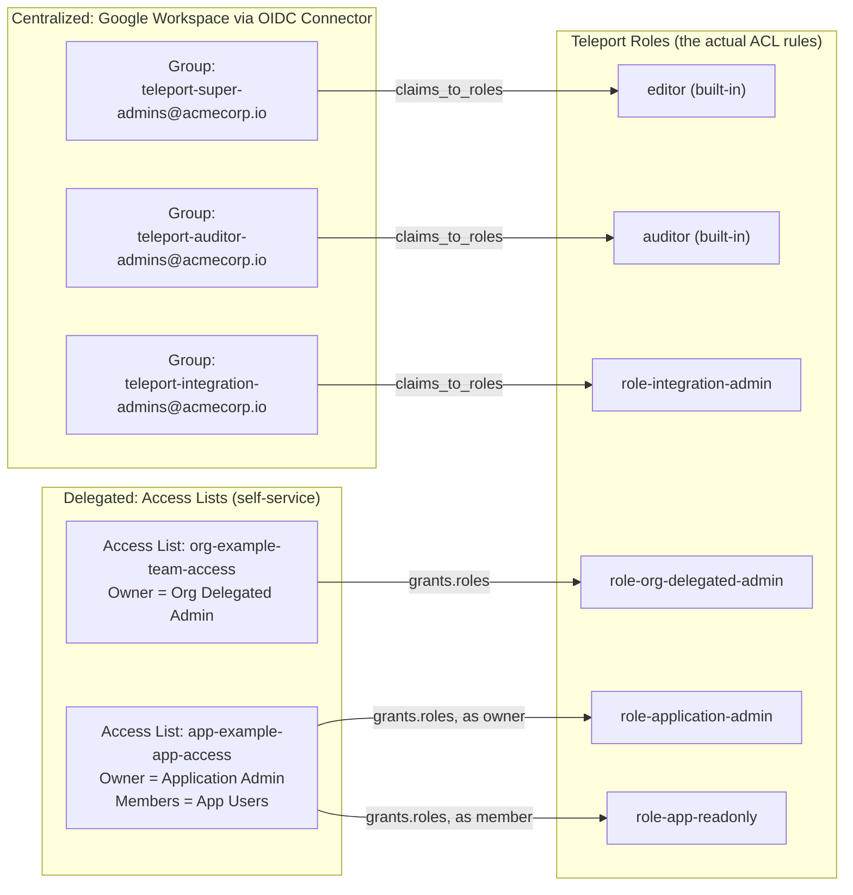
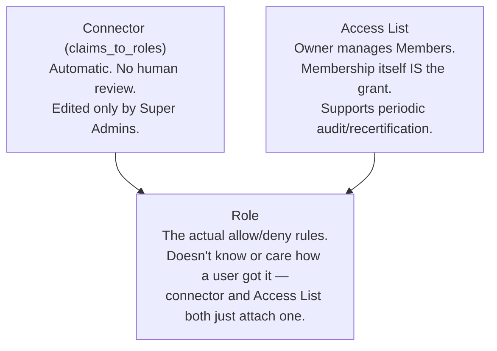

# How roles and Access Lists work together

Two different mechanisms decide who ends up holding a given Teleport
role in this design. This diagram traces both paths end to end. See
`README.md` for the prose version of this table.

## What each piece actually is

The role is the same kind of object either way — `editor`,
`role-application-admin`, etc. don't change behavior based on how
someone acquired them. The connector and Access Lists are just two
different **front doors** to the same back room. Centralized tiers use
the connector because membership changes rarely and should stay under
tight, central control. Delegated tiers use Access Lists because
membership changes often and an org/app owner — not a Super Admin —
should be the one managing it.

## The one thing this diagram doesn't show

Editing the underlying `app` resource definitions (not role
assignment, but the app's own URI/labels/etc.) uses neither mechanism
— that's the GitOps + CODEOWNERS pattern in `gitops/README.md`,
because neither roles nor Access Lists can scope a `create`/`update`
verb to a single resource instance. See `OPEN_QUESTIONS.md` #5.
